# zwm

Gestor de ventanas en mosaico para X11, escrito en Zig. Incluye barra superior, panel lateral
(calendario, música y notificaciones), widget de escritorio, notificaciones emergentes, lanzador de
aplicaciones con calculadora integrada y órdenes de música por texto («pon ...», que controla Spotify en
cualquier dispositivo) y pantalla de bloqueo con contraseña (PAM).

Está hecho para un escritorio personal: la configuración vive en código (`src/config.zig`) y los
textos de la interfaz están en español.


---

## Índice

1. [Requisitos](#requisitos)
2. [Compilar, probar e instalar](#compilar-probar-e-instalar)
3. [Sesión y arranque](#sesión-y-arranque)
4. [Atajos de teclado](#atajos-de-teclado)
5. [Ratón](#ratón)
6. [Mosaico y ventanas](#mosaico-y-ventanas)
7. [Workspaces](#workspaces)
8. [Barra superior](#barra-superior)
9. [Widget de escritorio](#widget-de-escritorio)
10. [Panel lateral](#panel-lateral)
11. [Notificaciones](#notificaciones)
12. [Lanzador, calculadora y música](#lanzador-y-calculadora)
13. [Bloqueo de pantalla](#bloqueo-de-pantalla)
14. [Volumen, música y red](#volumen-música-y-red)
15. [Configuración](#configuración)
16. [Arquitectura del código](#arquitectura-del-código)
17. [Cómo se generaron las capturas](#cómo-se-generaron-las-capturas)
18. [Limitaciones y estado](#limitaciones-y-estado)

---

## Requisitos

Dependencias de compilación (todas enlazadas en `build.zig`):

| Biblioteca | Para qué |
|---|---|
| `xcb`, `xcb-keysyms`, `xcb-shape` | Protocolo X, teclado y ventanas con esquinas redondeadas |
| `libsystemd` (sd-bus) | Notificaciones, MPRIS y NetworkManager por D-Bus |
| `freetype2` | Texto con JetBrains Mono (si no se encuentra, usa una fuente de mapa de bits) |
| `pam` | Comprobar la contraseña del bloqueo (servicio `system-local-login`) |

Requiere **Zig 0.16**. Además, en tiempo de ejecución:

- `wpctl` (PipeWire/WirePlumber) para el volumen. Sin él, el volumen no aparece.
- NetworkManager, para el nombre de la red y el tipo de conexión.
- Opcional: cualquier reproductor con MPRIS (Spotify, mpv, navegadores...) para la tarjeta de música.
- Opcional: `imagemagick` (y `curl` para portadas remotas) para mostrar la portada del álbum. Sin ellos la tarjeta muestra una nota musical.
- Opcional: la fuente **JetBrains Mono** (o JetBrains Mono Nerd Font Mono) en `/usr/share/fonts/`.
- Opcional: `xterm`, que es la terminal que abre `Super+Return`.
- Opcional, para las órdenes de música: `python3` (solo biblioteca estándar), `notify-send` (libnotify) y Spotify Premium; ver [Música](#música-por-teclado-pon-).

---

## Compilar, probar e instalar

```sh
zig build            # compila en zig-out/bin/wm
zig build test       # tests unitarios: calculadora, apps (.desktop), store (notificaciones), panel (ajuste de texto), árbol BSP
zig build run        # arranca el WM dentro de la sesión X actual (DISPLAY)
```

Para instalarlo como sesión de inicio de sesión (SDDM, GDM, LightDM...):

```sh
./install.sh             # compila con -Drelease y copia los ficheros con sudo
./install.sh uninstall   # quita los ficheros y el directorio /usr/local/share/zwm
```

`install.sh` instala:

| Destino | Contenido |
|---|---|
| `/usr/local/bin/zwm` | el WM |
| `/usr/local/bin/zwm-session` | el script de sesión X |
| `/usr/local/bin/zwm-music` | helper de música (Spotify Connect) del lanzador |
| `/usr/share/xsessions/zwm.desktop` | entrada de sesión para el gestor de inicio |
| `/usr/local/share/zwm/zwm.Xresources` | tema de `xterm` |
| `~/.config/zwm/autostart` | programas de arranque del usuario (solo si no existe) |

Tras instalar, elige **zwm** en el menú de sesiones de tu gestor de inicio.

---

## Sesión y arranque

`session/zwm-session` es el script que ejecuta el gestor de inicio. Hace lo mínimo antes de mostrar el
escritorio:

1. Exporta `XDG_SESSION_TYPE=x11`, `XDG_CURRENT_DESKTOP=zwm` y `XDG_SESSION_DESKTOP=zwm`.
2. Si no hay bus de sesión, lo arranca con `dbus-run-session`, porque el WM usa D-Bus para
   notificaciones, MPRIS y NetworkManager.
3. Pasa `DISPLAY` y `XAUTHORITY` a `systemd --user` y a la activación D-Bus.
4. Pone el cursor `left_ptr` (si no, X muestra la «X» por defecto en el escritorio vacío).
5. Carga el tema de `xterm` (`zwm.Xresources`) y después `~/.Xresources`, si existe.
6. Ejecuta `zwm` en bucle, con el registro en `~/.local/state/zwm/zwm.log`. El registro se rota
   al superar 1 MB. Si el directorio de estado no se puede escribir, el registro se descarta
   (`/dev/null`) y el WM arranca igual.

Comportamiento ante fallos:

- Si `zwm` sale con código 0, 130 o 143 (salir con el atajo, `Ctrl+C` o `SIGTERM`), la sesión termina.
- Si se cae, se reinicia tras 0,3 s y **readopta** las ventanas que siguen abiertas, cada una en su
  workspace.
- Si cae 5 veces en una ventana corta de tiempo, la sesión se rinde.

El programa de arranque `~/.config/zwm/autostart` se ejecuta **una vez por sesión**, justo después del
primer fotograma del WM, así que no se repite tras un reinicio por fallo. La versión que instala
`install.sh` abre Obsidian y una sesión de Claude Code en `~/Proyectos`, y deja un hueco para tus
propios programas (polkit, fondo de pantalla, compositor...).

---

## Atajos de teclado

`Super` es la tecla Windows/Meta. Todos los atajos se capturan en la raíz de la pantalla; también
funcionan con Bloq Mayús o Bloq Num activados. Si cambia la distribución del teclado, los atajos se
vuelven a registrar solos.

### Aplicaciones y ventanas

| Atajo | Acción |
|---|---|
| `Super+Return` | Abre una terminal (`xterm`) |
| `Super+c` | Abre una terminal nueva con Claude Code en `~/Proyectos` (`claude`, sin retomar la sesión anterior) |
| `Super+q` | Cierra la ventana enfocada. Pide cerrarla con `WM_DELETE_WINDOW`; si el programa no lo soporta, la mata con `XKillClient` |
| `Super+Space` | Muestra u oculta el panel lateral |
| `Alt+Space` | Abre el lanzador (sin `Super`) |
| `Super+l` | Bloquea la pantalla |
| `Super+Shift+e` | Sale del WM (la sesión termina con código 0 y no se reinicia) |

### Foco, movimiento y tamaño

| Atajo | Acción |
|---|---|
| `Super+←↑→↓` | Enfoca la ventana vecina en esa dirección |
| `Super+Shift+←↑→↓` | Intercambia la ventana enfocada con su vecina |
| `Super+Alt+←↑→↓` | Redimensiona: mueve la división que separa la ventana enfocada en esa dirección (paso de 3 %) |

### Workspaces

| Atajo | Acción |
|---|---|
| `Super+1` … `Super+5` | Cambia al workspace 1–5 |
| `Super+Shift+1` … `Super+Shift+5` | Envía la ventana enfocada al workspace 1–5 |

### Teclas multimedia (sin `Super`)

| Tecla | Acción |
|---|---|
| `XF86AudioMute` | Silenciar o activar (`wpctl set-mute ... toggle`) |
| `XF86AudioLowerVolume` | Bajar el volumen un 5 % |
| `XF86AudioRaiseVolume` | Subir el volumen un 5 %, sin pasar del 100 % |
| `XF86AudioPrev` / `XF86AudioPlay` / `XF86AudioNext` | Anterior, reproducir/pausar y siguiente en el reproductor MPRIS |

> Nota: estas teclas no se pudieron probar con pulsaciones reales (el teclado virtual de las pruebas no
> las tiene). Los controles de música sí se probaron con el ratón en el panel; ver
> [Volumen, música y red](#volumen-música-y-red).

### Dentro del lanzador

| Tecla | Acción |
|---|---|
| Escribir | Filtra aplicaciones y evalúa la expresión |
| `↑` / `↓`, `Tab` / `Shift+Tab`, `Ctrl+p` / `Ctrl+n` | Mueve la selección |
| `Return` / `Intro del teclado numérico` | Ejecuta la fila seleccionada |
| `Ctrl+u` | Borra la búsqueda |
| `Retroceso` | Borra el último carácter |
| `Esc` o `Ctrl+c` | Cierra el lanzador |

Con el lanzador abierto, las combinaciones con `Super` siguen siendo atajos: `Super+l`, por ejemplo,
bloquea igualmente.

### Dentro de la pantalla de bloqueo

Ver [Bloqueo de pantalla](#bloqueo-de-pantalla).

---

## Ratón

- **Pasar el puntero por una ventana** la enfoca. No ocurre mientras las ventanas se están
  deslizando, para que el movimiento no robe el foco.
- **Clic en un toast** lo cierra (la notificación sigue en el panel).
- **Clic en una notificación del panel** la descarta.
- **Clic en ⏮ / ⏯ / ⏭** en la tarjeta de música del panel: anterior, reproducir/pausar y siguiente.
- **Clic en una fila del lanzador** la selecciona y la ejecuta, igual que `Return`.
- Durante el bloqueo, los clics se ignoran.

---

## Mosaico y ventanas

El mosaico es un **árbol binario de particiones (BSP)** por workspace:

- Cada hoja es una ventana. Cada nodo interno es una división horizontal o vertical con una proporción
  (`ratio`, 0,5 al crear).
- Una ventana nueva **divide la ventana enfocada** por su lado más largo: si la ventana es más ancha
  que alta, la división es horizontal (lado a lado); si no, es vertical.
- Al cerrar una ventana, su hermano ocupa el espacio del padre.
- Separación entre ventanas: 6 px. Borde: 2 px. Borde enfocado azul (`#4796d9`), normal gris (`#636c7e`).
- Límite: 256 ventanas por workspace (`Tree.max_leaves`). Las que pasen de ese número no entran en el
  cálculo de foco ni de geometría.

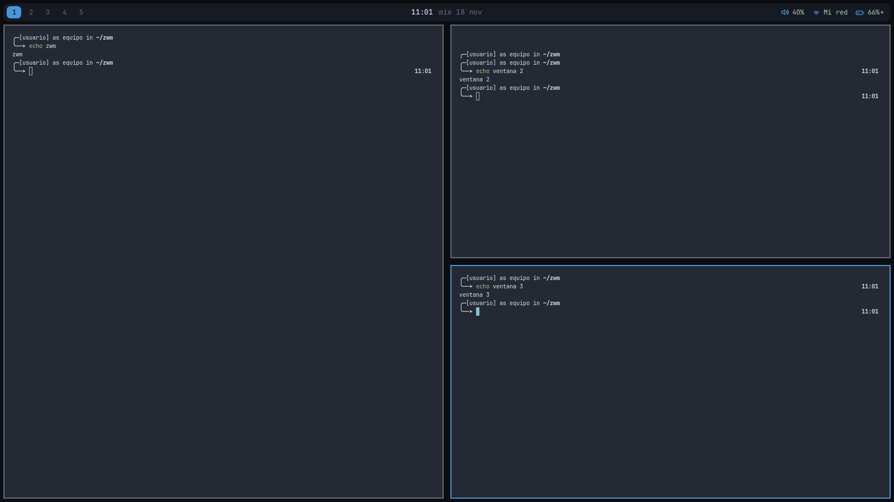

**Enfoque.** `Super+flechas` busca la ventana vecina más cercana en esa dirección, que tenga solape en
el eje perpendicular. Si no hay vecina, no pasa nada.

**Intercambio.** `Super+Shift+flechas` intercambia la ventana enfocada con su vecina. Las dos ventanas
se deslizan hasta su nueva posición.

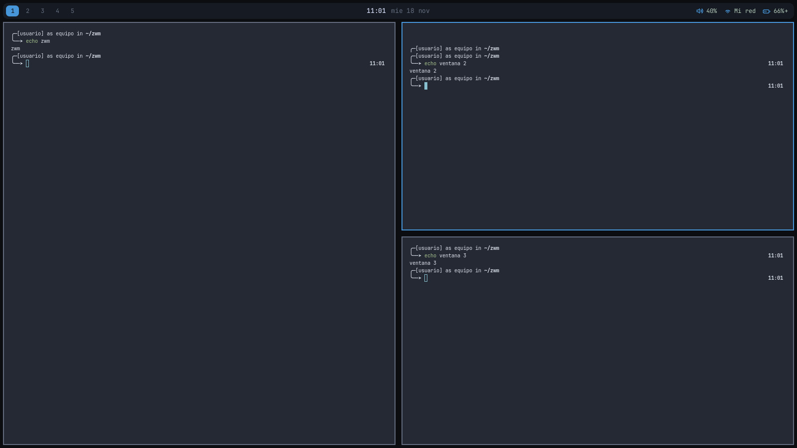

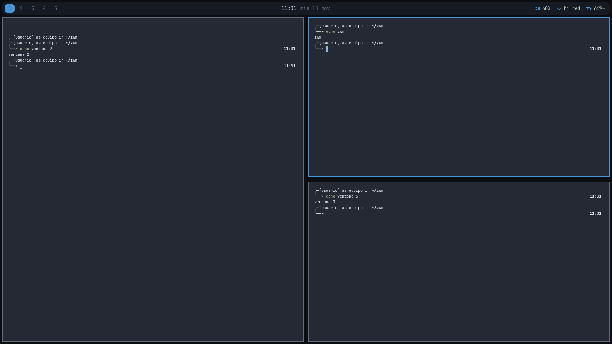

**Redimensionado.** `Super+Alt+flechas` busca la división más cercana con esa orientación que separa la
ventana enfocada del lado hacia el que se empuja. Hacia la derecha o abajo, la ventana tiene que estar en
la primera mitad de la división; hacia la izquierda o arriba, en la segunda. La proporción queda entre
0,1 y 0,9.

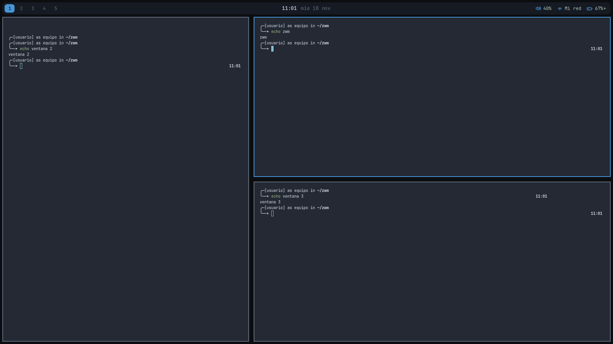

**Animación.** Las posiciones se deslizan con un decaimiento exponencial a 144 Hz (sin rebote). El
**tamaño** cambia de golpe: cada cambio de tamaño envía una señal `SIGWINCH` al programa, y una terminal
redibuja su prompt en cada una, así que animar el tamaño llenaba las terminales de prompts repetidos.

**Ventanas flotantes.** No entran en el mosaico si tienen `WM_TRANSIENT_FOR` o si su
`_NET_WM_WINDOW_TYPE` es uno de: `DIALOG`, `SPLASH`, `UTILITY`, `DOCK`, `MENU`, `DROPDOWN_MENU`,
`POPUP_MENU` o `TOOLTIP`. Si no piden posición, se centran en la zona útil (bajo la barra). Si no hay
memoria para el árbol, la ventana también se muestra flotante en vez de quedarse oculta.

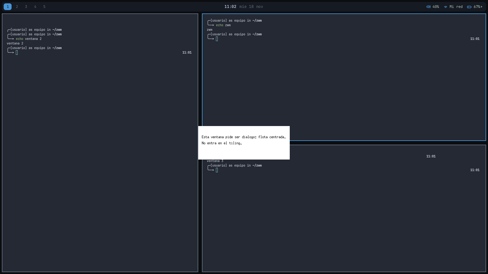

**Ventanas ya abiertas.** Al arrancar, el WM adopta las ventanas que ya existen en X y las devuelve a su
workspace (propiedad `_NET_WM_DESKTOP`); las de otros workspaces quedan ocultas en su sitio. Por eso un
reinicio tras un fallo no deja ventanas huérfanas. Las ventanas de override-redirect (menús, tooltips) no
se tocan, y las ocultas sin marca de workspace se ignoran.

**Cerrar una ventana.** `Super+q` envía `WM_DELETE_WINDOW`, y el programa decide si cierra. Si el
programa no soporta ese protocolo, se mata la conexión X.

---

## Workspaces

Hay 5 workspaces (`cfg.workspaces`). Cada uno tiene su propio árbol de ventanas. Al cambiar de workspace:

- Las ventanas del workspace que se deja **salen deslizándose** hacia el lado correspondiente y luego se
  ocultan.
- Las del nuevo workspace **entran deslizándose** desde el mismo lado.
- Si una ventana vuelve antes de que termine su salida, retoma desde donde iba.

`Super+Shift+N` mueve la ventana enfocada al workspace N. Se oculta y queda en el árbol del destino. Cada
ventana guarda su workspace en `_NET_WM_DESKTOP`, así que un reinicio del WM la devuelve a su sitio.

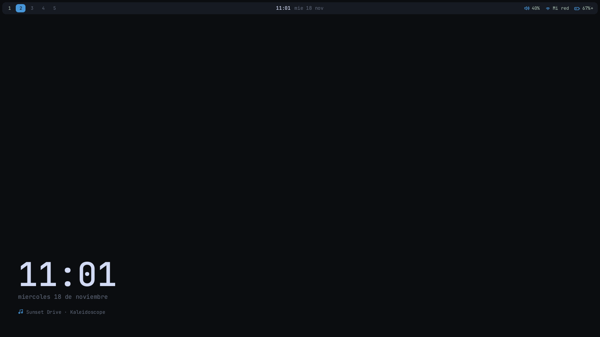

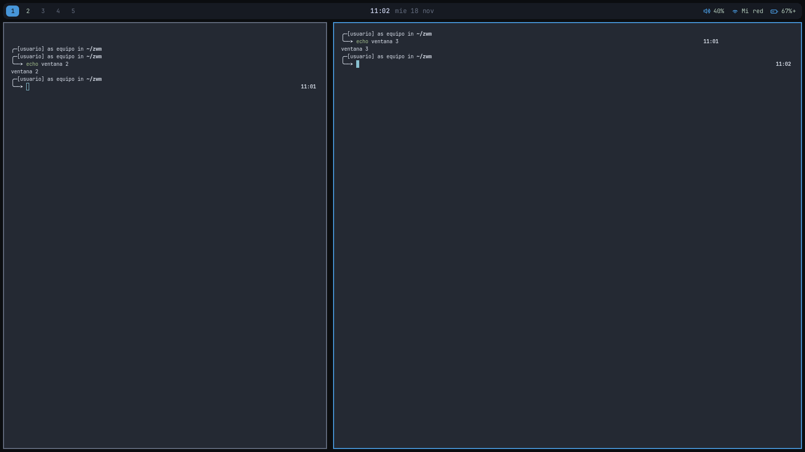

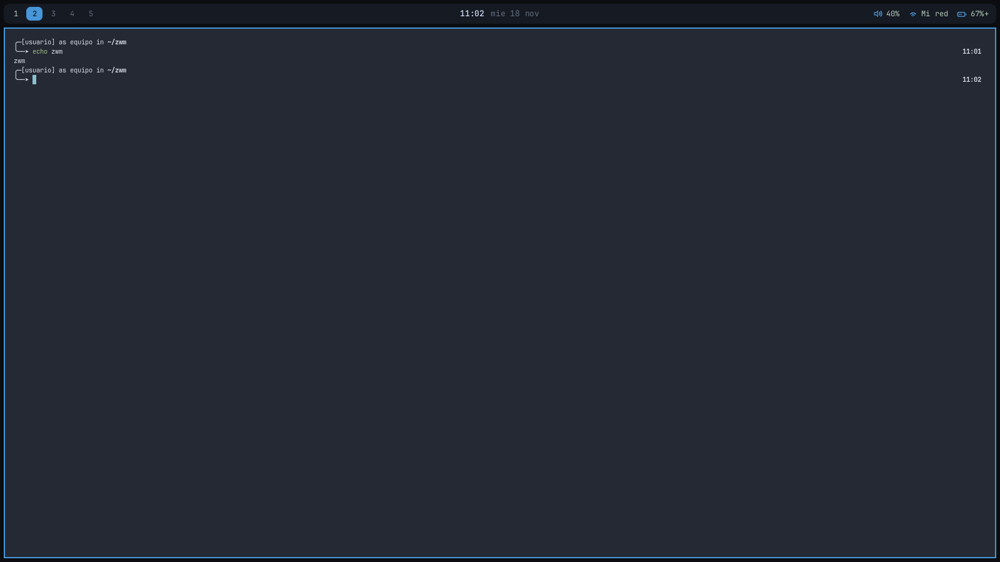

---

## Barra superior

Barra flotante de 32 px, con esquinas redondeadas y un margen de 6 px. Ocupa el borde superior de la
pantalla y reserva ese espacio al mosaico.

- **Izquierda:** los números de los workspaces 1–5. La «píldora» azul marca el activo y se desliza al
  cambiar. Un número en gris indica un workspace vacío; uno en blanco, un workspace con ventanas.
- **Centro:** hora `HH:MM` y fecha con nombres abreviados en español (`lun 19 oct`).
- **Derecha:** de derecha a izquierda, batería (`100%`, con `+` si carga), red (nombre de la Wi-Fi, `eth`,
  o `sin red`) y volumen (`40%`, o `mute`).

La barra se repinta solo cuando cambia algo visible (minuto, workspace, red, volumen...). La batería se
lee de `/sys/class/power_supply` como mucho cada 20 s. La primera fuente de tipo `Battery` es la que se usa.
Las lecturas de ficheros sysfs ignoran cualquier cosa que no sea un fichero regular, para que una FIFO
en esa ruta no bloquee el bucle principal.


> En las capturas el nombre de la Wi-Fi está tapado con «Mi red».

---

## Widget de escritorio

Cuando el escritorio está vacío (o detrás de las ventanas), se ve en la esquina inferior izquierda:

- La hora en grande (88 px).
- La fecha completa: `lunes 19 de octubre`.
- Si hay música reproduciéndose, una línea con `título · artista`.

El widget queda siempre **por debajo** de las ventanas en mosaico.

---

## Panel lateral

`Super+Space` abre un panel de 320 px en el lado derecho, que se desliza desde fuera. Se cierra con el
mismo atajo. Tiene tres tarjetas:

1. **Calendario.** Mes y año en el título, `sem N` (semana ISO) a la derecha, la cuadrícula de lunes a
   domingo y el día de hoy resaltado en azul.
2. **Música.** Aparece si hay un reproductor MPRIS en este PC o si suena Spotify en otro dispositivo
   (móvil, otro PC; ver [Música por teclado](#música-por-teclado-pon-)). Muestra la portada del álbum
   (esquinas redondeadas), el título, el artista (con el dispositivo si no es este PC), los controles
   ⏮ ⏯ ⏭ junto a la portada y debajo una barra de progreso con el tiempo transcurrido y la duración.
   La posición se actualiza cada segundo mientras suena. Si ambos suenan a la vez, gana el de este PC.
3. **Notificaciones.** La lista de las últimas notificaciones (hasta 16), con la aplicación, el resumen y
   el contador. Un clic descarta una.

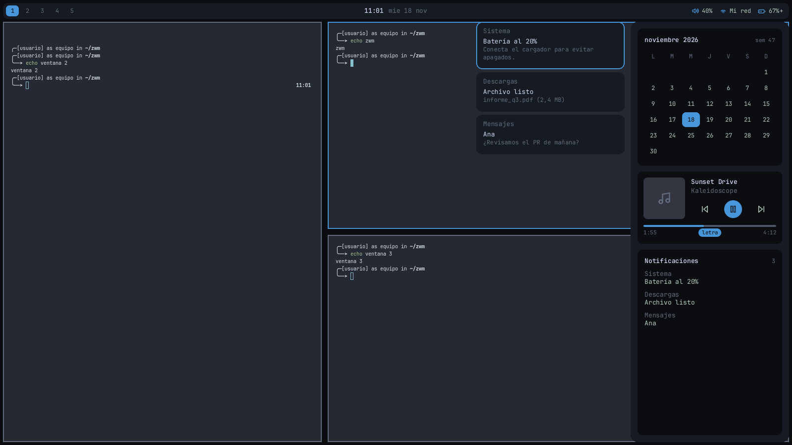

Con el panel abierto, los toasts se desplazan a la izquierda para no taparlo.

**Controles de música.** Probados con un reproductor MPRIS de prueba: los clics en ⏭, ⏯ y ⏮ llegaron
al reproductor como `Next`, `PlayPause` y `Previous`, y la tarjeta cambió de pista y de estado.

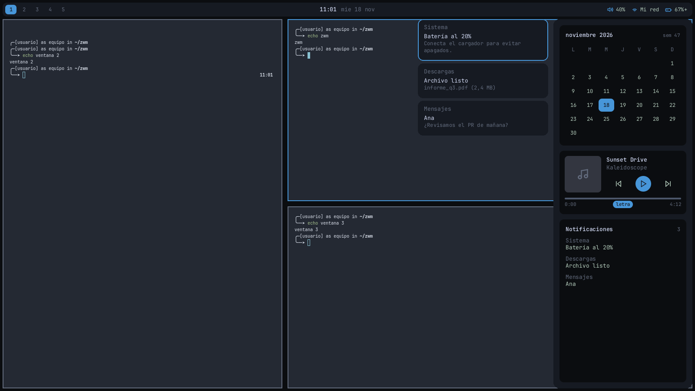

---

## Notificaciones

zwm implementa el servidor `org.freedesktop.Notifications` en el bus de sesión:

- `Notify`: añade la notificación. Si `replaces_id` apunta a una existente, la sustituye y la pone al
  frente, sin crear otra; pero solo si la existente la envió el mismo cliente. Si no, se crea una nueva.
- `CloseNotification`: la descarta, pero solo si la envió el mismo cliente.
- `GetCapabilities` (solo anuncia `body`), `GetServerInformation`.

Si ya hay otro servidor de notificaciones en la sesión, el nombre está ocupado y zwm no hace nada: el
otro sigue funcionando.

**Propiedad.** Cada notificación recuerda el nombre de bus de quien la envió. Otro cliente no puede
sustituirla ni cerrarla, aunque conozca su número.

**Duración del toast:** `-1` (valor por defecto del protocolo) son 5 s; `0` son 8 s; otro valor se
limita a 10 s como máximo.

**Toasts:** hasta 3 a la vez, en la esquina superior derecha, bajo la barra. Entran deslizándose desde la
derecha. La más nueva tiene borde de acento. Un clic cierra el toast, pero la notificación queda en el
panel.

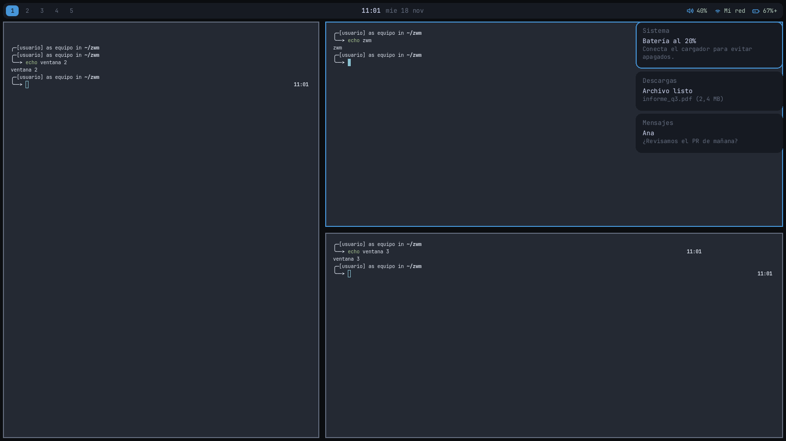

**Avisos del propio WM.** Algunos avisos los genera zwm, con la aplicación «zwm»: por ejemplo, «No se pudo
abrir el lanzador» si otra aplicación tiene el teclado, o «No se pudo bloquear».

**Texto.** Los caracteres de control se sustituyen por espacios. Los caracteres invisibles que cambian el
orden de lectura (marcas bidi, espacios de anchura cero) se eliminan, para que un texto no pueda parecer
distinto de lo que dice. Con la fuente TTF, el UTF-8 se conserva; sin ella, se pasa a ASCII (las vocales
acentuadas se convierten en su equivalente Latin-1, y lo que no se puede representar pasa a `?`). El texto se corta en 2 líneas en los toasts.

---

## Lanzador y calculadora

`Alt+Space` abre un panel a la izquierda, con un campo de búsqueda y hasta 10 resultados. Mientras está
abierto, **captura el teclado**: las teclas van al lanzador, salvo las combinaciones con `Super`.

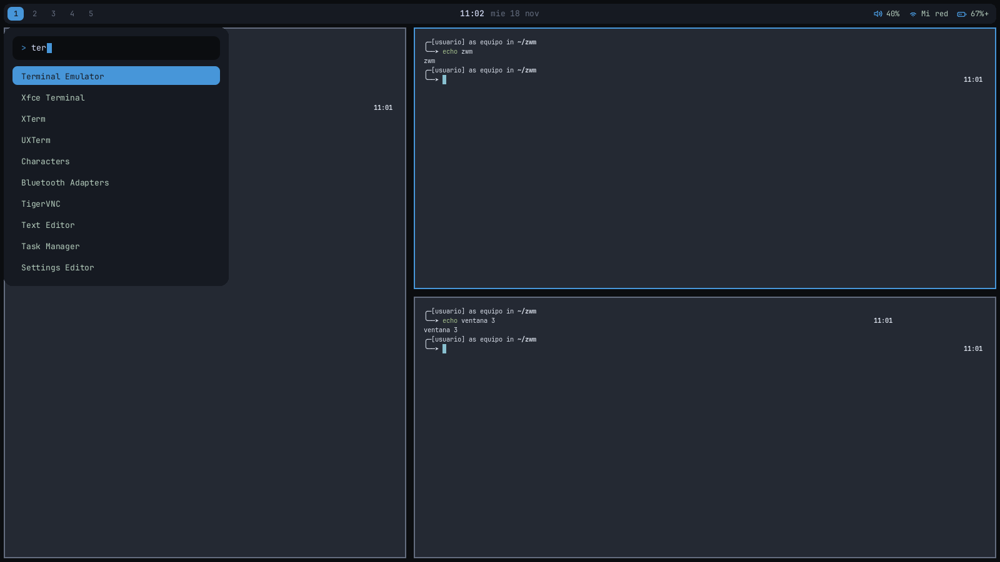

**Aplicaciones.** Se leen los `.desktop` de:

1. `~/.local/share/applications` (tiene prioridad),
2. `/usr/local/share/applications`,
3. `/usr/share/applications`,
4. `/var/lib/flatpak/exports/share/applications`.

Se omiten los que tienen `NoDisplay=true` o `Hidden=true`, los que no son `Type=Application`, y los que
no tienen `Name` o `Exec`. Si dos tienen el mismo nombre, gana el primero encontrado. El índice se
reconstruye solo cuando cambia la fecha de alguno de esos directorios. La primera vez que el WM queda
inactivo se escanean en segundo plano, para que el primer `Alt+Space` sea inmediato. Mientras el lanzador
muestra resultados no se reindexa, para que la lista no cambie bajo el cursor.

**Búsqueda difusa.** Cada letra de la consulta debe aparecer en el nombre, en orden (no hace falta
seguida). Se puntúa más si:

- coincide al principio del nombre o de una palabra (tras espacio, `-`, `_` o `.`),
- forma una secuencia seguida,
- el nombre empieza por la consulta,
- contiene la consulta tal cual.

Las aplicaciones más usadas suben: cada uso suma 4 puntos, hasta 20 usos. Los contadores se guardan en
`~/.cache/wm-launcher`.

**Ejecutar.** `Return` lanza la fila seleccionada. Las aplicaciones con `Terminal=true` se ejecutan dentro
de la terminal configurada (`xterm -e ...`). Los códigos de campo (`%U`, `%F`...) se eliminan.

**Si no se puede abrir.** Si otra aplicación tiene el teclado, el lanzador no se abre y el WM lo indica con
un aviso.

**Calculadora.** Si la consulta es una expresión válida, aparece como primera fila con `=` y el
resultado. Operadores: `+ - * / %`, potencia `^` (asociativa por la derecha), `x` como multiplicación,
paréntesis y menos unario. Un número suelto (`42`) **no** cuenta como cálculo, para que las búsquedas
de aplicaciones no se rompan.

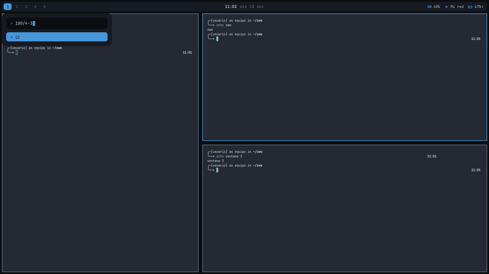

Al activar la fila de la calculadora, el resultado se guarda como notificación de la aplicación
«calc» (aparece como toast y en el panel). No se copia al portapapeles.

### Música por teclado («pon ...»)

El lanzador también entiende órdenes de música. Se controla **Spotify Connect** por la Web API, así que
funciona con el dispositivo que esté sonando (el móvil, un altavoz, este PC), no sólo con un reproductor
local.

| Escribes | Hace |
|---|---|
| `pon cerati cuando pase el temblor` | Busca la canción y la reproduce (también `poneme`, `play`, `toca`, `reproduce`) |
| `pon la cancion X`, `pon algo de X` | Igual; «la cancion», «el tema» o «algo de» se ignoran. `pon la camisa negra` busca tal cual |
| `pon el disco de X`, `pon disco X` | Busca un álbum y lo reproduce entero |
| `pausa`, `play`, `siguiente`, `anterior` | Controles (también `stop`, `sigue`, `next`, `prev`...) |

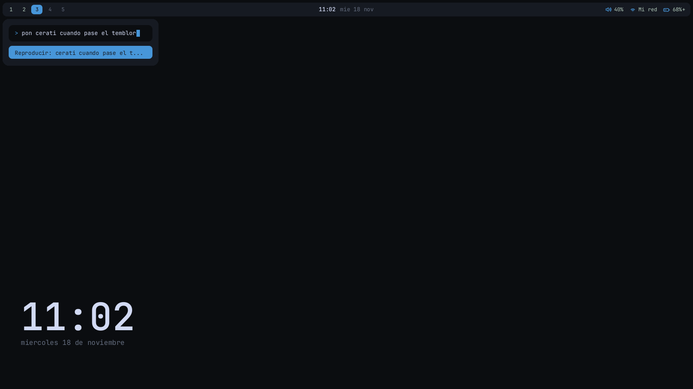

Aparece una fila de acción arriba del todo; `Return` la ejecuta y el resultado llega como notificación:
la canción como título y, debajo, el artista y el dispositivo.

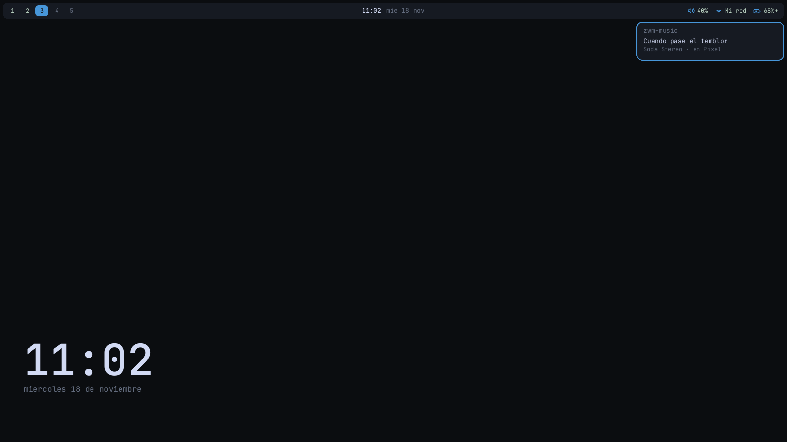

El dispositivo elegido es el activo; si no hay ninguno, un móvil; si no, cualquiera que Spotify vea. El
lanzador no escribe acentos: la búsqueda de Spotify los ignora.

**Configuración (una vez).** Necesitas Spotify **Premium** (limitación de la API para controlar la
reproducción) y una app propia, gratis:

1. En <https://developer.spotify.com/dashboard> crea una app, con la *Redirect URI*
   `http://127.0.0.1:8888/callback` (tiene que ser la IP, no `localhost`) y la API *Web API*.
2. Copia su *Client ID* y ejecuta `zwm-music login CLIENT_ID`. Se abre el navegador; al aceptar, los
   tokens quedan en `~/.config/zwm/spotify.json` (permisos `600`). No usa *client secret* (PKCE).
3. Prueba con `zwm-music devices` (lista lo que Spotify ve) y luego `Alt+Space` → `pon ...`.

`zwm-music` es un script de Python sin dependencias (`session/zwm-music`, instalado por `install.sh` en
`/usr/local/bin`). Las órdenes se interpretan en `src/intent.zig`; lo que escribes viaja entre comillas
simples, nunca lo interpreta el shell.

**Lo que suena en otros dispositivos.** Con Spotify autorizado, el WM lanza `zwm-watch` al arrancar
(`src/watch.zig`, un binario estático en Zig que instala `install.sh`; ocupa ~1 MB de RAM y mantiene una
sola conexión TLS abierta): pregunta a la Web API cada 3 s (6 s en pausa, 10 s si no hay nada) y la tarjeta
del panel y la línea del widget muestran lo que suene en el móvil u otro PC. Los botones ⏮ ⏯ ⏭ y las teclas multimedia
controlan entonces a ese dispositivo vía Spotify, no MPRIS. Prioridad: un reproductor local sonando >
Spotify sonando en otro dispositivo > lo que esté en pausa. Sin autorizar, el watcher termina solo y se
reintenta cada minuto.

---

## Bloqueo de pantalla

`Super+l` bloquea la pantalla:

- Ocupa toda la pantalla con una ventana sin gestor (override-redirect) y **captura el teclado**. Mientras
  está activo, ningún atajo del WM funciona.
- Muestra la hora en grande, el nombre del usuario y una animación de «estratos» en forma de ondas que
  responde a cada tecla. El fondo es una imagen estática de los mismos estratos.
- Cada carácter escrito añade un punto (hasta 32 visibles). El último es naranja.
- La contraseña se comprueba con **PAM**, servicio `system-local-login`, para el usuario que ejecuta el WM.
  Se lee con `getpwuid` y no se guarda ninguna copia fuera del búfer de PAM.
- `Return` la comprueba. Si está vacía, muestra el error **sin llamar a PAM**.
- `Esc` o `Ctrl+u` borran la contraseña; `Retroceso` borra un carácter (respetando UTF-8).
- Acentos muertos: `´`, `` ` ``, `¨`, `^` y `~` se combinan con la vocal o la consonante siguiente
  (`´` + `a` = `á`, `~` + `n` = `ñ`).
- Si la contraseña es correcta, el bloqueo se cierra y el foco vuelve a la ventana que había.
- Si es incorrecta, los estratos se ponen rojos y los puntos tiemblan durante 0,9 s con el texto
  «contraseña incorrecta».
- Mientras está activo, los clics se ignoran, y ninguna ventana puede quedar por encima: el WM reafirma el
  bloqueo cada vez que aparece una ventana, incluidas las de override-redirect (menús, popups).

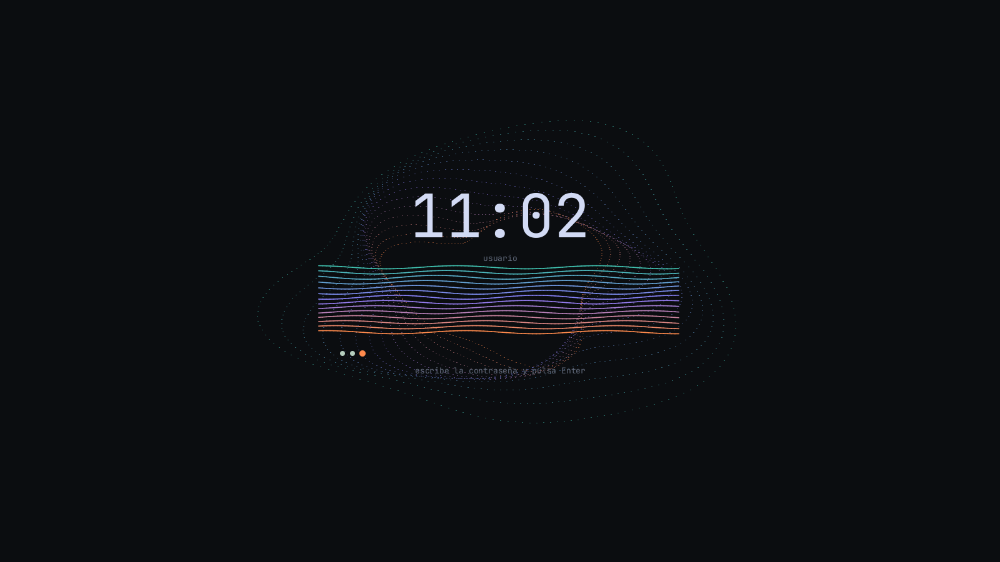

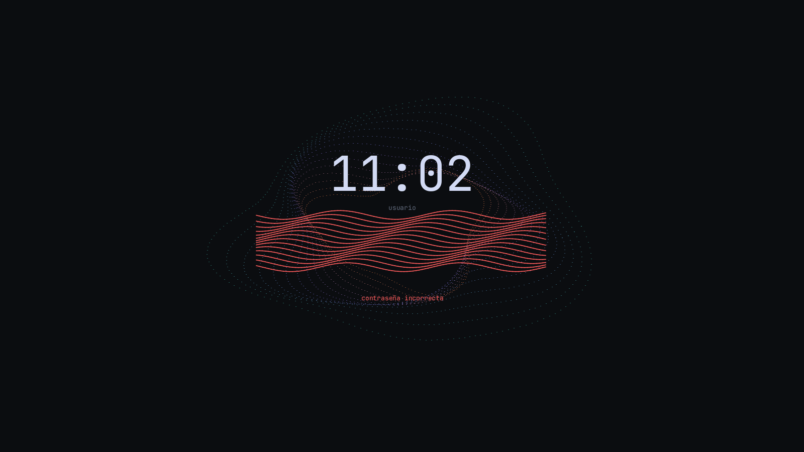

> Un Enter con contraseña escrita sí llama a PAM, y cuenta como intento fallido para el sistema. Las
> capturas se hicieron con el campo vacío precisamente por eso.

El bloqueo necesita una pantalla de al menos 720 × 340 px. Si no hay pantalla suficiente, o si otra
aplicación tiene el teclado, `Super+l` no bloquea y el WM lo indica con un aviso.

---

## Volumen, música y red

**Volumen.** Se lee y se cambia con `wpctl` sobre el dispositivo de salida por defecto. Como `wpctl` puede
tardar decenas de milisegundos, o quedarse colgado si PipeWire está caído, nunca se ejecuta en el bucle
principal: se lanza en un proceso hijo cuyo stdout se consulta con `poll`. Las órdenes de teclas se
encolan y se ejecutan en un solo lote, seguido de una lectura del volumen. El lote tiene un límite de
tiempo de 3 s más 1 s por cada 16 órdenes.

**Música (MPRIS).** Al arrancar y ante las señales `PropertiesChanged` o `NameOwnerChanged` de
`org.mpris.MediaPlayer2.*` se busca un reproductor en ese mismo espacio de nombres. Si hay varios, se
prefiere el que está reproduciendo. Se leen el estado, los metadatos (título, artista, duración) y la
posición. La portada (`mpris:artUrl`, `file://` o `http(s)://`) se descarga y escala a 84×84 en un proceso
hijo (`curl` + ImageMagick) que el bucle de eventos lee sin bloquearse; solo se pide con el panel abierto.
Si falla, la tarjeta muestra una nota musical. Los controles usan los métodos `PlayPause`, `Next` y `Previous` de
`org.mpris.MediaPlayer2.Player`.

**Red.** Escucha `StateChanged` de NetworkManager en el bus del sistema, y se vuelve a leer cada minuto.
Lee `PrimaryConnection`; si es inalámbrica, muestra el `Id` de la conexión (el SSID); si no, `eth`. Si no
hay conexión, `sin red`.

Todas las llamadas D-Bus tienen un tiempo límite de 150 ms, para que una app colgada no congele el WM.

---

## Configuración

Toda la configuración está en `src/config.zig`, en tiempo de compilación. Para cambiar algo, edita el
fichero y recompila (`zig build` o `./install.sh`).

| Constante | Valor por defecto | Qué controla |
|---|---|---|
| `mod_mask` | `64` (Super) | Tecla modificadora principal (`8` sería Alt) |
| `gap`, `border` | `6`, `2` | Separación y grosor del borde |
| `border_focus`, `border_normal` | `#4796d9`, `#636c7e` | Colores de los bordes |
| `resize_step` | `0.03` | Paso de `Super+Alt+flechas` |
| `bar_h`, `bar_radius`, `bar_bg` | `32`, `10`, `#161a22` | Barra superior |
| `desktop_bg` | `#0b0d10` | Fondo del escritorio y de las tarjetas |
| `accent`, `fg`, `fg_bright`, `fg_dim` | azul, gris, blanco, gris oscuro | Paleta de texto |
| `terminal` | `"xterm"` | Terminal de `Super+Return` y de las apps con `Terminal=true` |
| `claude_cmd` | `xterm ... claude` en `~/Proyectos` | Comando de `Super+c` |
| `anim_hz` | `144` | Cuadros por segundo de las animaciones |
| `k_window`, `k_workspace`, `k_pill`, `k_panel`, `k_toast`, `k_launcher` | `26`, `22`, `32`, `24`, `26`, `30` | Velocidad de cada animación (mayor = más rápida) |
| `workspaces` | `5` | Número de workspaces |
| `binds` | ver `config.zig` | Tabla de atajos: tecla, modificadores y acción |

Para añadir un atajo, añade una entrada a `base` en `config.zig` con su `keysym`, `extra` (`1` Shift,
`8` Alt), `mod` y `action`. Las acciones disponibles están en el `enum Action`.

El tema de `xterm` está en `session/zwm.Xresources` (Nord, con fuente JetBrains Mono de 10 pt). Lo que
tengas en `~/.Xresources` tiene prioridad sobre él.

---

## Arquitectura del código

| Fichero | Líneas | Responsabilidad |
|---|---:|---|
| `src/main.zig` | 901 | Bucle principal, ventanas, workspaces, atajos, animaciones, bloqueo, arranque |
| `src/panel.zig` | 514 | Panel lateral, widget de escritorio y toasts |
| `src/gfx.zig` | 456 | Canvas por software, fuente de mapa de bits (PSF) y TTF (FreeType), superficies X |
| `src/lock.zig` | 448 | Pantalla de bloqueo: dibujo, animación, teclado y acentos |
| `src/dbus.zig` | 325 | Servidor de notificaciones, MPRIS y NetworkManager |
| `src/apps.zig` | 293 | Lectura de `.desktop`, búsqueda difusa y contadores de uso |
| `src/launcher.zig` | 288 | Lanzador `Alt+Space` |
| `src/intent.zig` | 177 | Órdenes de música del lanzador («pon ...», «pausa») |
| `src/store.zig` | 248 | Estado compartido: notificaciones (con propietario), música, red, volumen |
| `src/tree.zig` | 182 | Árbol BSP del mosaico |
| `src/bar.zig` | 173 | Barra superior y lectura de batería |
| `src/sys.zig` | 152 | Volumen con `wpctl` sin bloquear, y ejecución de comandos |
| `src/calc.zig` | 145 | Evaluador de expresiones de la calculadora |
| `src/icons.zig` | 72 | Iconos vectoriales (volumen, Wi-Fi, batería, música) |
| `src/auth.zig` | 57 | Comprobación de contraseña con PAM |
| `src/config.zig` | 91 | Configuración en tiempo de compilación |
| `src/anim.zig` | 46 | Aproximación exponencial y `poll` con horario fijo |
| `src/c.zig` | 21 | Importación de las cabeceras de C |
| `session/` | | Script de sesión, entrada `.desktop`, tema de `xterm`, autostart de ejemplo |
| `session/zwm-music` | 269 | Helper de música: autorización PKCE, búsqueda y control por la Web API de Spotify |
| `install.sh` | 24 | Instalación y desinstalación |

**Flujo general.** Un único hilo espera con `poll` sobre la conexión X, los buses D-Bus y el proceso de
volumen. Cada vuelta procesa los eventos X, avanza las animaciones, repinta lo que cambió y se duerme
hasta el siguiente evento o hasta el siguiente minuto. En reposo el WM no despierta; durante una
animación va a 144 Hz.

**Estado.** `store.zig` contiene lo que se muestra fuera del mosaico (música, red, volumen, notificaciones)
y un contador de versión: cada widget repinta solo si esa versión cambió.

---

## Cómo se generaron las capturas

Las imágenes de este README son capturas reales de zwm compilado desde este repositorio, todas de la misma
pasada:

- Un servidor X anidado (`Xephyr` en `:1`, 1600 × 900).
- Un bus de sesión propio (`dbus-run-session`), para que las notificaciones y la música de las pruebas
  no se mezclaran con las del escritorio real. No se arrancó el autostart.
- Las pulsaciones se enviaron con XTEST, así que zwm las recibió como teclas reales.
- Un reproductor MPRIS de prueba con tres pistas, para la tarjeta de música.
- Notificaciones enviadas con `notify-send` al bus de prueba. La de `zwm-music` (captura 19) está simulada con
  `notify-send` con el mismo formato que usa el helper: no se llamó a Spotify de verdad.
- El nombre de la Wi-Fi está tapado con «Mi red» en todas las capturas con barra. Las de bloqueo no tienen barra.

---

## Limitaciones y estado

- **Un solo monitor.** Usa la pantalla 0 del servidor X y no detecta varios monitores.
- **Configuración fija.** Los cambios en `config.zig` exigen recompilar. No hay fichero de configuración.
- **Workspaces fijos** a 5, y 256 ventanas por workspace como máximo.
- **Diálogos de GTK.** Algunos diálogos de GTK se anuncian como `_NET_WM_WINDOW_TYPE_NORMAL` y, por tanto,
  se tilean. Por ejemplo, un `zenity --info` se tilea como una ventana normal. Los que anuncian `DIALOG` sí flotan.
- **Teclas multimedia sin probar con teclas reales.** El teclado virtual de las pruebas no tiene las teclas
  `XF86Audio*`. Su código está en `config.zig`; la ruta de MPRIS sí se probó con el ratón en el panel.
- **Escritorio sin composición.** No hay transparencias ni sombras: el «redondeo» de las esquinas se hace
  con la extensión SHAPE.
- **Ruta fija.** `claude_cmd` y el autostart de ejemplo usan `~/Proyectos`.
- **Música solo con Spotify Premium** y una app propia en el panel de desarrolladores de Spotify. La
  parte de Spotify se probó con la API simulada, no contra el servicio real. La tarjeta de música del
  panel solo ve reproductores MPRIS locales, no lo que suena en otro dispositivo.
- El directorio `.zig-cache/` ocupa unos 760 MB. Está en `.gitignore`, pero conviene borrarlo si hace falta
  espacio (`rm -rf .zig-cache`).
